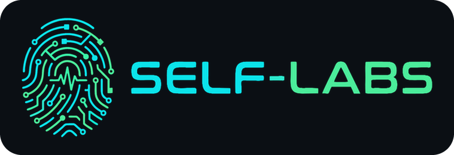

<p align="center">
  
</p>

# SelfDesk

Cliente de acesso remoto da Self-Labs, baseado no [RustDesk](https://github.com/rustdesk/rustdesk).
Ele já vem apontado para o servidor próprio (`rustdesk-id.selflabs.org`) e para o console
[CortenDesk](https://rustdesk.selflabs.org), com a marca Self-Labs. É só instalar e definir a senha:
nada de colar servidor e chave à mão em cada máquina.

Os instaladores são gerados pelo [rdgen](https://github.com/bryangerlach/rdgen) a partir do
[`selfdesk.json`](./selfdesk.json) e publicados nas [Releases](https://github.com/self-labs/selfdesk/releases)
por um workflow que roda todo dia e acompanha as versões novas do RustDesk sozinho.

## Download

Os nomes dos arquivos não levam versão, então estes links sempre entregam a Release mais recente:

| Sistema                | Arquivo                                                                                                      |
| :--------------------- | :----------------------------------------------------------------------------------------------------------- |
| Windows 64             | [`selfdesk.exe`](https://github.com/self-labs/selfdesk/releases/latest/download/selfdesk.exe) ou [`selfdesk.msi`](https://github.com/self-labs/selfdesk/releases/latest/download/selfdesk.msi) |
| Debian/Ubuntu x86_64   | [`selfdesk-x86_64.deb`](https://github.com/self-labs/selfdesk/releases/latest/download/selfdesk-x86_64.deb)   |
| Debian/Ubuntu ARM64    | [`selfdesk-aarch64.deb`](https://github.com/self-labs/selfdesk/releases/latest/download/selfdesk-aarch64.deb) |
| Outras distros Linux   | `.rpm`, `.AppImage`, `.flatpak` e `.pkg.tar.zst` na [Release](https://github.com/self-labs/selfdesk/releases/latest) |

Cada Release traz um `SHA256SUMS` para conferir os arquivos.

## Instalação

> [!WARNING]
> Se a máquina já tem o **RustDesk oficial**, desinstale antes. Os dois usam serviços com nomes
> diferentes (`rustdesk` e `selfdesk`), então rodariam juntos, cada um com o seu ID.

### Windows

Rode o `selfdesk.exe` e clique em **Instalar**. O `.msi` serve para instalação silenciosa ou por GPO.
Depois, em **Configurações → Segurança**, defina a **senha permanente** da máquina: sem ela o
SelfDesk não aceita conexão (a senha temporária fica desligada).

### Debian/Ubuntu (inclusive servidor sem tela)

```bash
cd /tmp && curl -fsSLO https://github.com/self-labs/selfdesk/releases/latest/download/selfdesk-x86_64.deb
sudo apt install -y ./selfdesk-x86_64.deb
```

O pacote instala o comando `selfdesk` e o serviço `selfdesk.service`, que ele mesmo habilita e inicia.
Os nomes com maiúsculas (`SelfDesk`, `SelfDesk.service`) também funcionam: o rdgen dá ao programa o nome
do app, e o workflow acrescenta ao `.deb` o comando e o apelido do serviço em minúsculas. Nos `.rpm`,
AppImage e flatpak, só vale `SelfDesk`.
A senha permanente vai por máquina, pelo terminal (o espaço antes do `sudo` tira a linha do histórico):

```bash
 sudo selfdesk --password 'SENHA_FORTE_DA_MAQUINA'
selfdesk --get-id
systemctl status selfdesk
```

## O que já vem configurado

Há três níveis: o que é **travado** (vai no `override-settings`, vale até numa máquina que já tinha outra
configuração, e o usuário não consegue trocar), o que é **padrão** (vem pronto, mas dá para mudar em
**Configurações**) e o que é **compilado** no programa.

### Travado

| Opção (chave do RustDesk)                                  | Valor                       | Efeito                                                              |
| :--------------------------------------------------------- | :-------------------------- | :------------------------------------------------------------------ |
| Modo de acesso (`access-mode`)                             | `full`                      | Acesso total                                                        |
| Teclado e mouse (`enable-keyboard`)                        | sim                         | Controla a máquina                                                  |
| Área de transferência (`enable-clipboard`)                 | sim                         | Copiar e colar entre as máquinas                                    |
| Transferência de arquivos (`enable-file-transfer`)         | sim                         |                                                                     |
| Áudio (`enable-audio`)                                     | sim                         | Som da máquina acessada                                             |
| Túnel TCP (`enable-tunnel`)                                | sim                         | Encaminhar portas (RDP, SSH...) pela sessão                         |
| Reiniciar remotamente (`enable-remote-restart`)            | sim                         |                                                                     |
| Gravar a sessão (`enable-record-session`)                  | sim                         |                                                                     |
| Bloquear a entrada do usuário (`enable-block-input`)       | sim                         | Trava teclado e mouse locais durante a sessão                       |
| Alterar a configuração remotamente (`allow-remote-config-modification`) | sim            | Quem acessa pode mudar as configurações desta máquina               |
| Impressora remota (`enable-remote-printer`)                | sim                         |                                                                     |
| Câmera (`enable-camera`)                                   | sim                         |                                                                     |
| Terminal (`enable-terminal`)                               | sim                         | Abre um terminal na máquina acessada                                |
| Senha aceita (`verification-method`)                       | `use-permanent-password`    | Só a permanente; a temporária fica desligada                        |
| Aprovação da sessão (`approve-mode`)                       | `password`                  | Só por senha; ninguém aprova por clique                             |
| Acesso por IP direto (`direct-server`)                     | não                         | Toda conexão passa pelo servidor de ID                              |
| Descoberta na rede local (`enable-lan-discovery`)          | sim                         | Aparece para outras máquinas da LAN                                 |
| Encerrar por inatividade (`allow-auto-disconnect`)         | não                         |                                                                     |
| Ocultar a janela de conexão (`allow-hide-cm`)              | sim                         | Quem está na frente **não** vê a janela da sessão                   |
| Remover o papel de parede na sessão (`allow-remove-wallpaper`) | sim                     | Imagem mais leve no acesso                                          |
| Link "Powered by" (`hide-powered-by-me`)                   | oculto                      |                                                                     |

### Padrão (o usuário pode mudar)

| Item                 | Valor                                                                                     |
| :------------------- | :---------------------------------------------------------------------------------------- |
| Servidor de ID/relay | `rustdesk-id.selflabs.org` (relay deduzido na 21117), em **Configurações → Rede**         |
| Key                  | a chave pública do servidor Self-Labs                                                     |
| API                  | `https://rustdesk.selflabs.org` (CortenDesk: a máquina aparece no console)                |
| Tema                 | segue o sistema                                                                           |
| Instalação e Configurações | liberadas                                                                           |
| Direção              | recebe e faz conexões                                                                     |

### Compilado

Nome (SelfDesk), ícone, logo, tela de privacidade, cores da Self-Labs, e o aviso de nova versão do
RustDesk oficial **desligado** (a atualização vem destas Releases). **Nenhuma senha vem embutida:** a
permanente é definida em cada máquina.

> [!IMPORTANT]
> A janela oculta depende de três opções juntas: aprovação só por senha, só senha permanente e
> `allow-hide-cm` (`hide_cm()` em `hbb_common/src/password_security.rs`). O rdgen só as liga com uma
> senha embutida no build, então elas vão pelo `overrideManual` do [`selfdesk.json`](./selfdesk.json).
> Consequência: **uma máquina sem senha permanente não aceita conexão**. Defina a senha logo na
> instalação.

## Builds automáticos

O workflow [`build.yml`](./.github/workflows/build.yml) roda todo dia às 01:23 (horário de São Paulo):

1. Lê a versão padrão do [rdgen público](https://rdgen.crayoneater.org). O rdgen só compila as versões
   do RustDesk que ele suporta, então uma versão nova só entra depois que ele a adiciona.
2. Se a Release `v<versão>` ainda não existe, gera Windows e depois Linux com o
   [rdgen-cli](https://github.com/AlekseyLapunov/rdgen-cli) (cerca de 40 minutos cada).
3. Publica a Release com todos os arquivos e o `SHA256SUMS`, marcada como a mais recente.

Para rodar na hora: **Actions → build → Run workflow**. O campo `version` força uma versão da lista do
rdgen, e `force` refaz uma Release que já existe (por exemplo, depois de mudar o JSON ou as imagens).

## Personalizar

- **Configuração:** abra o [rdgen](https://rdgen.crayoneater.org), use **Load Configuration** com o
  `selfdesk.json`, ajuste e salve com **Save Configuration** por cima dele. Depois rode o workflow com `force`.
- **Imagens:** as três de [`brand/`](./brand/) (ícone, logo e tela de privacidade) saem do
  [`build-brand.py`](./brand/build-brand.py) a partir do logo da Self-Labs. Regeradas, elas precisam
  voltar para dentro do JSON (pelo **Load/Save** do rdgen).

## Créditos e licença

O SelfDesk **não é um produto oficial do RustDesk**. Ele existe graças a:

- **[RustDesk](https://github.com/rustdesk/rustdesk)**, da Purslane Ltd. e colaboradores, o software de acesso
  remoto em que ele se baseia (AGPL-3.0).
- **[rdgen](https://github.com/bryangerlach/rdgen)**, de Bryan Gerlach, que aplica a personalização e compila
  os clientes (GPL-3.0).
- **[rdgen-cli](https://github.com/AlekseyLapunov/rdgen-cli)**, de Aleksey Lapunov, que dispara o rdgen pelo
  workflow (MIT).

Este repositório está sob a [AGPL-3.0](./LICENSE), a mesma licença do RustDesk. O código-fonte de cada
build está indicado nas notas da Release correspondente: a tag do RustDesk usada, os patches do rdgen e
a configuração deste repositório no commit que gerou os arquivos.

A marca Self-Labs e suas imagens são de propriedade da Self-Labs, todos os direitos reservados, e não
estão incluídas na licença AGPL-3.0 do código.
